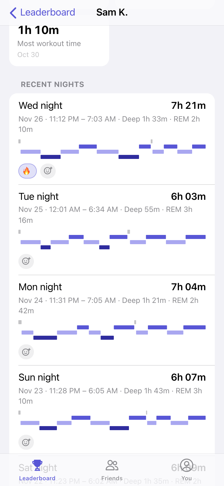

# Rested

An app to compare sleep scores from Google Fitbits with your friends.

<p align="center">
  
  
  
</p>

## Features

- Leaderboards for last night, this week or this month
- Sleep stats: time asleep, deep, REM, light, efficiency, bedtime and how consistent your bedtime is
- Activity stats: steps, Zone Minutes, workouts, calories, distance and floors
- Add friends with a link or a QR code
- Tap on a friend to see your record against them, their recent nights and their workouts
- React to a friend's night or workout with an emoji
- Every Monday it shows who won each category the week before
- Notifications when someone passes you or reacts to something
- You can add it to your home screen and use it like an app. It has dark mode and works offline

Google doesn't give out its Sleep Score through the API, so the app just ranks the raw numbers.

<p align="center">
  
  
</p>

## How it works

You sign in with Google and give it read-only access to your sleep and activity data. The app saves one row per person per day with their totals, plus a list of workouts. It doesn't keep minute by minute data.

Data gets updated in three ways. Google Health sends a webhook when new data comes in, the app syncs when you open it, and a cron job runs once a day to catch anything that was missed. The leaderboards and weekly winners are all calculated from the daily rows.

Google tokens are encrypted in the database.

## Stack

- Next.js on Vercel
- Postgres on Supabase
- Google Health API
- Web Push for notifications
- Vitest for tests

## Running it locally

Copy `.env.example` to `.env.local` and fill it in, then:

```bash
npm install
npm run dev
npm test
```

The database schema is in `db/migrations/`.
