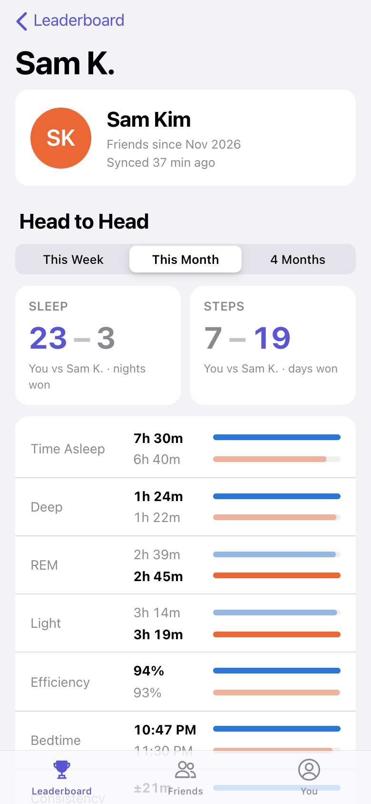
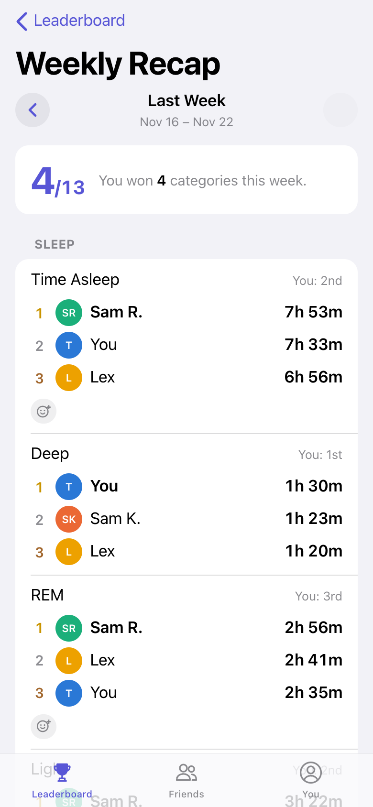

# Rested

Me and my friends wanted to see who sleeps the most. Google Health only lets you compare steps with friends, so I made this. It uses the Google Health API to pull sleep and activity data and puts everyone on a leaderboard.

  
  
  

Built with Next.js and Supabase. To run it locally, fill in `.env.local` (see `.env.example`), then `npm install` and `npm run dev`.
