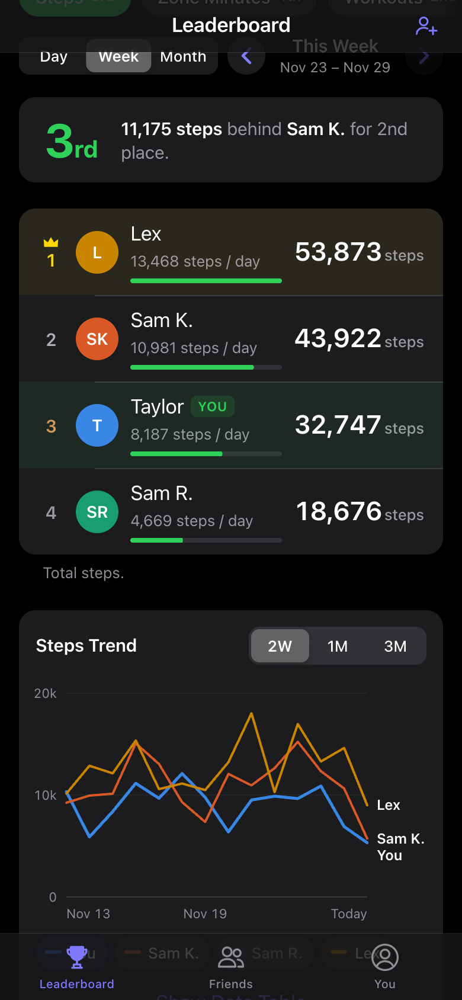

# Rested

Sleep and activity leaderboards for friends with Fitbits. Google Health only lets you compare steps, so this pulls everyone's data from the Google Health API and ranks it.

<p align="center">
  
  
  
</p>

## What's in it

- Leaderboards by night, week or month for time asleep, deep/REM/light sleep, efficiency, bedtime, steps, Zone Minutes, workouts, calories, distance and floors
- Add friends with a link or QR code, no groups
- Friend profiles with your head-to-head record, their recent nights and workouts
- Emoji reactions
- A weekly recap of who won each category
- Push notifications when someone passes you or reacts
- Installable as a web app, works in dark mode and offline

The numbers come straight from Google Health. Google's Sleep Score isn't in the API, so there isn't one here.

<p align="center">
  
  
</p>

## How it works

You sign in with Google and grant read-only sleep and activity access. The server saves one summary row per person per day, plus workouts. Data refreshes from Google Health webhooks, when you open the app, and in a daily cron job. Rankings and weekly winners are computed from the daily rows.

Next.js on Vercel, Postgres on Supabase, Web Push for notifications. Google tokens are encrypted at rest.

## Development

```bash
cp .env.example .env.local   # fill in
npm install
npm run dev
npm test
```

The database schema is in `db/migrations/`.
