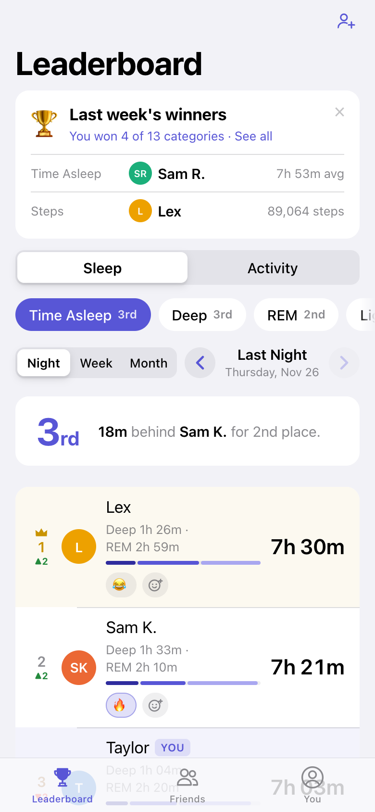

# Rested

A small web app for competing with friends on sleep (and steps, and workouts) using data from Google Health / Fitbit.

<p align="center">
  
  
  
</p>

## Why this exists

My friends and I all wear Fitbits. The Google Health app will happily let you compare steps with friends, but not sleep, and sleep is the one we actually argue about. So I built a tiny app that reads everyone's data (with permission) and puts us on the same leaderboard.

It's meant for a handful of friends, not the whole internet. There's no App Store version. It's a web app you add to your home screen, which turned out to be plenty.

## What it does

- **Leaderboards for last night, this week or this month.** Sleep: time asleep, deep, REM, light, efficiency, bedtime and bedtime consistency. Activity: steps, Zone Minutes, workout time, active calories, distance and floors. Each chip shows where you stand, and arrows show who moved up or down since the last period.
- **Friends, not groups.** Everyone has a personal link (and QR code). If someone opens yours, you're friends and you see each other's stats. Either of you can remove the other.
- **Profiles and head-to-head.** Tap anyone to see your record against them ("you won 23 of the last 26 nights"), every metric side by side, their personal bests, recent nights with a sleep-stage graph, and their workouts.
- **Reactions.** Drop a 🔥 on a friend's 9-hour night or a 😴 on their 5-hour one.
- **Weekly winners.** Every Monday you get a recap of who won each category. Sleep categories need 4 tracked nights, so one lucky night can't win the week.
- **Push notifications** (opt-in): when a friend passes you in steps, out-sleeps you, reacts to something, or the weekly results are in.
- **Feels like an app.** Installable PWA, dark mode, works offline with the last data it saw, pull to refresh, iOS-style transitions.

Scores come straight from Google Health. Google doesn't expose its own Sleep Score through the API, so Rested doesn't invent one; it ranks the raw numbers instead.

<p align="center">
  
  
</p>

## How it works

1. You sign in with Google and grant two read-only scopes: sleep, and activity & fitness. Nothing else.
2. The server pulls daily roll-ups (steps, distance, floors, calories, Zone Minutes), sleep sessions and exercise sessions from the [Google Health API](https://developers.google.com/health), and stores **one summary row per person per day** plus a list of workouts. Raw minute-by-minute data is never kept.
3. Data stays fresh three ways:
   - Google Health sends **webhooks** when new data lands. Sleep and workouts sync right away; step-type updates are debounced to once every 10 minutes per person.
   - The app syncs you (and any friends whose data is stale) **when you open it**.
   - A **daily cron job** catches anything missed and sends the Monday recap.
4. Everything else (rankings, head-to-head, weekly winners) is computed from those daily rows.

Google refresh tokens are encrypted at rest (AES-256-GCM). The database is only reachable by the app's own role: row-level security is on with no policies, so Supabase's public API keys can't read anything.

### Stack

- [Next.js 16](https://nextjs.org) (App Router, server actions, React 19 view transitions) on Vercel
- Postgres on [Supabase](https://supabase.com) via the transaction pooler, using [`postgres`](https://github.com/porsager/postgres)
- Google OAuth + Google Health API v4
- Web Push with VAPID ([`web-push`](https://github.com/web-push-libs/web-push)) and a small hand-written service worker
- No UI framework: plain CSS with an iOS-flavored design system in `src/app/globals.css`
- [Vitest](https://vitest.dev) for the ranking, award and sync-mapping logic

### Project layout

```
src/
  app/                 routes: (app)/ is the signed-in shell with the tab bar
    api/               auth callback, sync, webhooks, cron, push subscribe
    actions.ts         server actions (friends, reactions, settings)
  components/          board, profile, reactions, charts, PWA bits
  lib/
    health.ts          Google Health API client (with retry/backoff)
    sync-map.ts        pure mapping from API responses to daily rows
    sync.ts            fetch → upsert → "you got passed" notifications
    metrics.ts         metric definitions and ranking math
    awards.ts          weekly winners and overtake detection
    push.ts            Web Push sending with per-type prefs and dedupe
db/migrations/         SQL, applied in order
public/sw.js           service worker: push, notification taps, offline pages
test/                  unit tests
```

## Running your own

You'll need a Google Cloud project, a Postgres database (Supabase's free tier works well), and somewhere to host Next.js (Vercel's free tier works).

### 1. Database

Create a Supabase project (or any Postgres 15+) and run the files in `db/migrations/` in order. The first one expects a login role named `rested_app` to own the tables:

```sql
CREATE ROLE rested_app LOGIN PASSWORD 'pick-a-long-random-password';
```

Use the **transaction pooler** connection string (port 6543) with that role as `DATABASE_URL`.

### 2. Google Cloud

1. Create a project and enable the **Google Health API** (`health.googleapis.com`).
2. Under Google Auth Platform, set the audience to **External** and add the scopes `googlehealth.sleep.readonly` and `googlehealth.activity_and_fitness.readonly`.
3. Create an OAuth **Web** client with the redirect URI `https://<your-domain>/api/auth/callback` (and `http://localhost:3000/api/auth/callback` for development).
4. Set the publishing status to **In production**. In "Testing" mode Google expires refresh tokens after 7 days, which means everyone gets logged out weekly. Without Google's verification the app is capped at 100 users and people see an "unverified app" screen once. That's fine for a friend group.
5. Register a webhook subscriber so Google pushes new data to you (you need the project **number**):

```bash
curl -X POST "https://health.googleapis.com/v4/projects/$PROJECT_NUMBER/subscribers?subscriberId=rested-webhooks" \
  -H "Authorization: Bearer $(gcloud auth print-access-token)" \
  -H "x-goog-user-project: $PROJECT_ID" -H "Content-Type: application/json" \
  -d '{
    "endpointUri": "https://<your-domain>/api/webhooks/google-health",
    "endpointAuthorization": { "secret": "Bearer '"$WEBHOOK_SECRET"'" },
    "subscriberConfigs": [{
      "dataTypes": ["sleep","steps","distance","floors","active-zone-minutes","exercise"],
      "subscriptionCreatePolicy": "AUTOMATIC"
    }]
  }'
```

### 3. Environment

Copy `.env.example` to `.env.local` and fill it in. Each variable has a comment saying what it's for. Generate the push keys with `npx web-push generate-vapid-keys`. Put the same variables in your host's environment settings for production.

### 4. Deploy

Deploy to Vercel (or anywhere that runs Next.js). `vercel.json` sets up the daily cron job, which needs `CRON_SECRET`.

## Development

```bash
npm install
npm run dev     # http://localhost:3000
npm test        # unit tests
npm run lint
```

## Good to know

- **iPhone notifications** only work after adding the app to the Home Screen (iOS 16.4+). That's an Apple rule for web apps. The app nudges people to do it.
- **Units are imperial** (miles), because that's who it was built for.
- **Times are local.** A night counts toward the day you woke up, and each person's "today" follows their own time zone.
- **Privacy.** Your stats are visible only to people you're friends with on Rested. Deleting your account removes all your data and revokes Google access. See `src/app/privacy/page.tsx` for the full policy.
